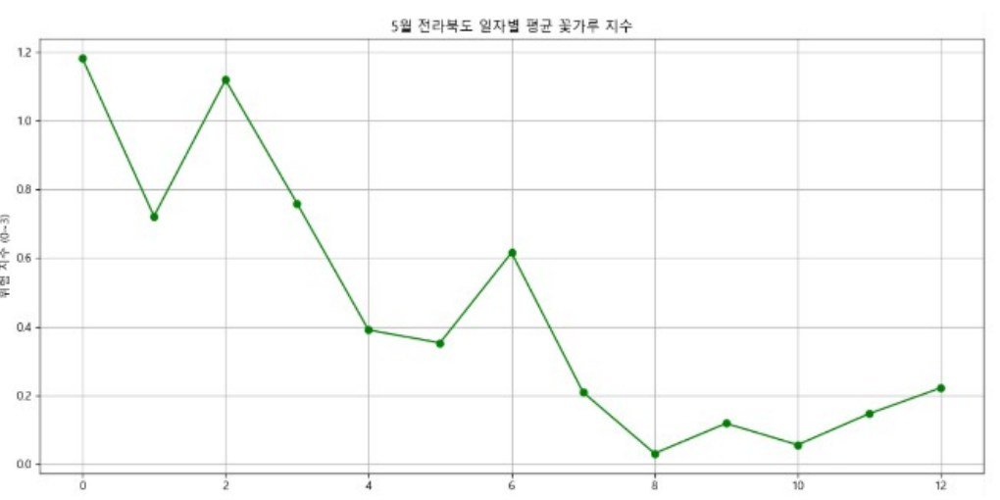
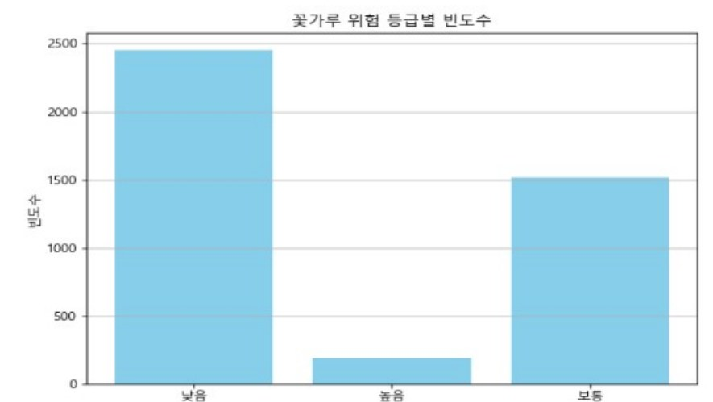
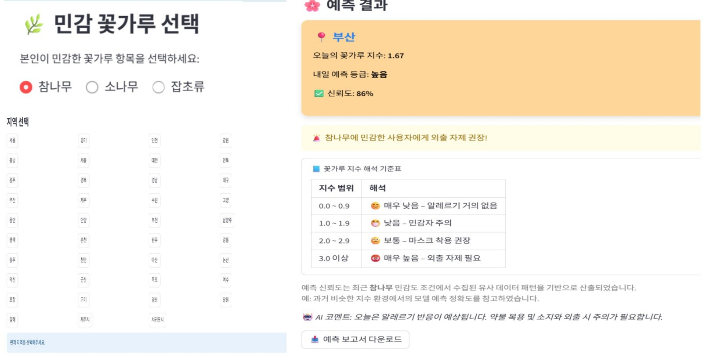

> **꽃가루 위험일 41%, 하루 먼저 알립니다**
> 2025.05.22 ~ 06.17 (약 41시간) · 개인 프로젝트 · 데이터분석기초 기말 프로젝트
> **역할:** 기획 · 분석 · 개발 전 과정

[한 장 요약 PDF 보기](/files/pollen-portfolio.pdf) · 💻 [GitHub 코드 보기](https://github.com/mungangbin/Portfolio)

---

## 1. 왜 이 서비스인가

| 지표 | 수치 | 출처 |
|:--|:--|:--|
| 알레르기 비염 진료 환자 | **740만 명** (2024) | 건강보험심사평가원 |
| 3년간 증가 | **1.5배** (491만 → 740만) | 건강보험심사평가원 |
| 9~11월 환자 집중 | **49%** | 가을 잡초류 꽃가루 영향 |

환자는 많고 계속 늘고 있지만, 지금의 꽃가루 정보는

- 지역별 **0~3 숫자 지수**로만 제공되고
- 내가 **어떤 꽃가루에 민감한지** 반영되지 않으며
- **오늘 무엇을 해야 하는지**는 사용자가 직접 해석해야 합니다.

 **목표:** 위험 패턴을 분석해 *"내일 내 지역은 얼마나 위험한가"*를 알려 주기

---

## 2. 데이터와 방법

**데이터:** 기상청 꽃가루농도 위험지수 (공공데이터포털) · 2025.05.01 ~ 05.13 · 일별 CSV 13개

`공공데이터 CSV 13개` → `pandas 전처리` → `5가지 분석` → `마르코프 체인 예측` → `Streamlit 화면`

**전처리 4단계** — 약 5만 행 → 전라북도 4,160행 한 표

1. **병합** — glob으로 `202505*.csv` 13개 자동 병합
2. **분리** — `#`로 이어진 문자열을 지점 · 날짜 · 지수 컬럼으로
3. **변환** — `2025050218` → 날짜형, 지수는 숫자형 (빈 값 0)
4. **등급** — 0~3 → 낮음 · 보통 · 높음 · 매우높음, 2 이상 경고

**분석으로 던진 질문**

| 질문 | 방법 |
|:--|:--|
| 언제 가장 위험했나? | 날짜별 평균 지수 |
| 위험한 날은 얼마나? | 등급별 빈도 |
| 위험이 이어지나? | 3일 연속 고위험 탐지 |
| 요일마다 다른가? | 요일별 평균 지수 |
| 예보는 안정적인가? | 모레 vs 내일 예보 차이 |

**사용 기술:** Python · pandas · NumPy · matplotlib · seaborn · Streamlit · 마르코프 체인

---

## 3. 분석 결과

| 41% | 2.6배 | 1.18 → 0.03 | 0.28 |
|:--:|:--:|:--:|:--:|
| 보통 이상 위험일 (1,706 / 4,160건) | 목요일 0.70 vs 월요일 0.27 | 일별 평균 지수 (5/1 → 5/9) | 모레 · 내일 예보 평균 차이 |

5월 초에는 평균 1 이상(보통)이었다가 5월 4일 이후 급격히 낮아졌습니다.

낮음이 절반을 넘지만 보통 이상도 40%가 넘어, 민감자에게는 주의가 필요한 날이 많았습니다.

---

## 4. 분석에서 기획으로

| 분석에서 찾은 사실 | ➡ | 그래서 이렇게 기획했습니다 |
|:--|:--:|:--|
| 보통 이상이 **41%** | ➡ | 숫자 대신 **등급 + 행동 가이드** (보통부터 마스크 권장) |
| 요일별 최대 **2.6배** 차이 | ➡ | 매일 **'내일 예측 등급'** 제공 |
| 예보에도 오차 (평균 **0.28**) | ➡ | 예측 결과에 **신뢰도** 함께 표시 |

---

## 5. 서비스 화면

**사용 흐름:** ① 민감한 꽃가루 고르기 → ② 지역 고르기 → ③ 오늘 지수 · 내일 등급 확인 → ④ 행동 가이드 · 보고서 저장

*부산 · 참나무를 고르면 오늘 지수, 내일 예측 등급, 외출 자제 경고, 지수 해석 기준표가 한 화면에 나타납니다.*

---

## 6. 배운 점

분석 결과는 숫자로 끝나지 않고, **사용자가 무엇을 할지까지 이어질 때** 쓸모가 생긴다는 것을 배웠습니다.
앞으로도 데이터로 문제를 찾고, 그 근거로 서비스를 기획하겠습니다.
